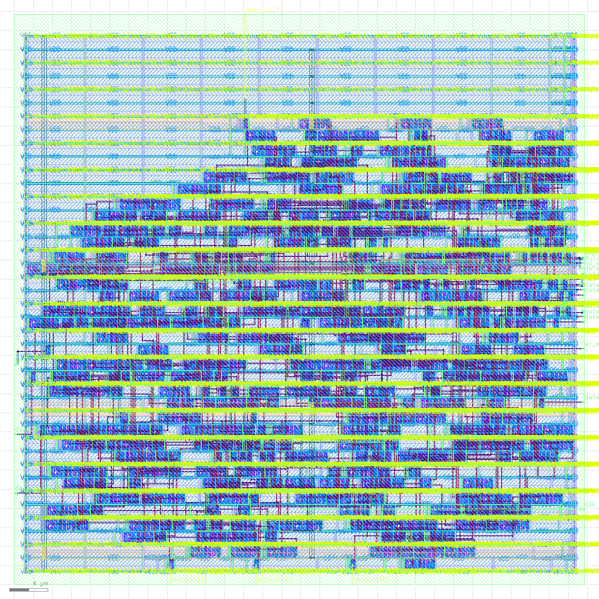
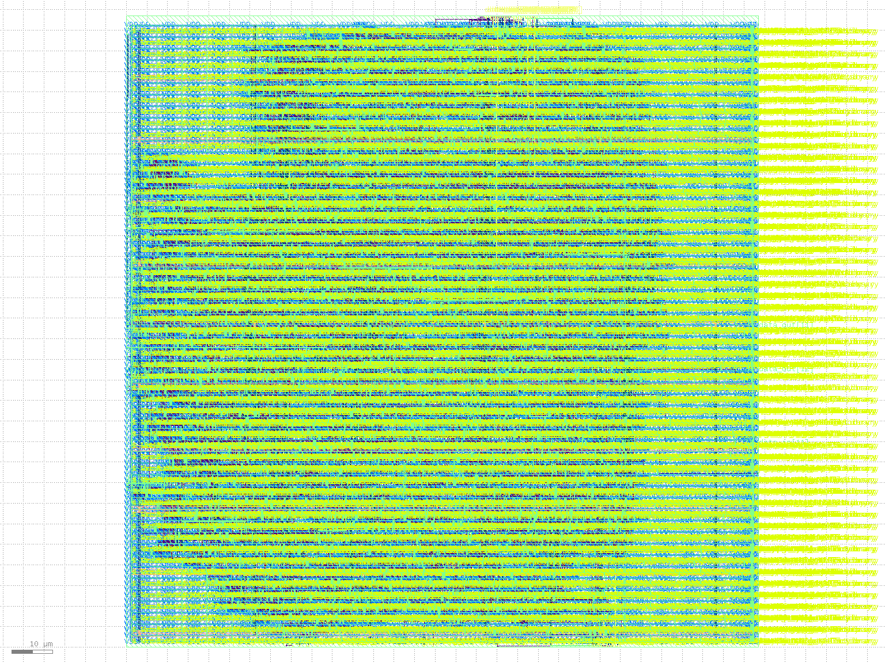
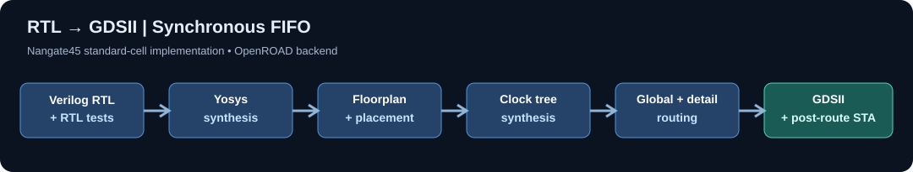

# Synchronous FIFO: RTL-to-GDSII Physical Design

**Two configurations of one parameterized FIFO—8-bit × 16-entry and 32-bit × 32-entry—implemented through place-and-route and GDSII generation with Yosys, OpenROAD, and the Nangate45 platform.**

This project demonstrates the complete *educational* digital physical-design workflow: RTL design, directed functional verification, generic synthesis, standard-cell implementation, floorplanning, placement, clock-tree synthesis, routing, and post-route timing analysis. The goal is to compare how increasing both FIFO word width and depth changes implementation cost and timing.

**Quick navigation:** [RTL](rtl/fifo_sync.v) · [Verification](tb/) · [Implementation setup](openroad/) · [Timing evidence](reports/) · [Final GDSII](layout/) · [Engineering notes](docs/engineering_notes.md)

## Results at a glance

| Metric | 8-bit × 16-entry | 32-bit × 32-entry |
|---|---:|---:|
| Stored data | 128 bits | 1,024 bits |
| Clock period constraint | 2.00 ns | 2.00 ns |
| Mapped standard cells¹ | 658 | 3,988 |
| Standard-cell area¹ | 1,355.8 µm² | 9,216.1 µm² |
| Core utilization¹ | 42.05% | 40.68% |
| Worst reported **setup-path slack**² | +1.2864 ns | +1.2059 ns |
| Worst reported **hold-path slack**² | +0.0920 ns | +0.0910 ns |
| Setup / hold violation count² | 0 / 0 | 0 / 0 |
| Setup TNS² | 0.00 ns | 0.00 ns |
| Estimated minimum period² | 0.71 ns | 0.79 ns |
| Estimated maximum frequency² | 1.401 GHz | 1.259 GHz |

**Takeaway:** An 8× increase in storage capacity was accompanied by approximately **6.8× cell area** and **6.1× cell count**. Both designs met the recorded 2 ns timing constraint at the reported analysis corner. Because both word width and depth increased, this comparison does not isolate either parameter's individual impact.

¹ Cell counts, area, and utilization are verified against the recovered, **original finish-stage JSON reports**: [8×16](reports/fifo_8x16/6_report.json) and [32×32](reports/fifo_32x32/6_report.json). The files were recovered byte-for-byte from the October 11, 2026 OpenROAD runs. The correct fields are `finish__design__instance__count__stdcell`, `finish__design__instance__area__stdcell`, and `finish__design__instance__utilization__stdcell`. See [measurement provenance](docs/engineering_notes.md#measurement-provenance).

² Full-precision worst-path slacks and the zero-violation counts come from those same [8×16 JSON](reports/fifo_8x16/6_report.json) and [32×32 JSON](reports/fifo_32x32/6_report.json) reports; compare with the original [8×16 STA report](reports/fifo_8x16/final_timing.rpt) and [32×32 STA report](reports/fifo_32x32/final_timing.rpt). The STA text reports print `wns max 0.00` when no negative-slack paths exist; **positive worst-path slack is not positive WNS**. Fmax is an STA estimate, not measured silicon speed.

## Physical implementation

### Final routed layouts — KLayout

The following are **KLayout-exported images from the original routed GDSII databases**, showing both designs at their final physical implementation stage. The layer colors are visualization settings; these images are illustrative evidence of geometry, not signoff proof.

| 8-bit × 16-entry FIFO | 32-bit × 32-entry FIFO |
|:---:|:---:|
| [](docs/images/fifo_8x16_klayout.png) | [](docs/images/fifo_32x32_klayout.png) |
| 128 storage bits · 658 standard cells | 1,024 storage bits · 3,988 standard cells |

The original GDSII files are available for independent inspection: [8×16](layout/fifo_8x16/fifo_8x16.gds) · [32×32](layout/fifo_32x32/fifo_32x32.gds). Screenshots are generated with [KLayout export script](scripts/export_klayout_images.rb).

### Flow overview

[](docs/flow_overview.svg)

The repository contains the **actual final GDSII outputs** for [8×16](layout/fifo_8x16/fifo_8x16.gds) and [32×32](layout/fifo_32x32/fifo_32x32.gds). Open them in KLayout to inspect the final physical layout. GDSII files cannot be previewed as ordinary images directly on GitHub.

Use `python3 scripts/summarize_finish_metrics.py` to extract and check the two finish-stage reports. See the [evidence index](reports/README.md) for metric sources and caveats. The original final DEF and OpenDB files were recovered as well, but are kept out of the repository to avoid duplicating bulky generated artifacts; the GDSII files are already checked in.

The physical flow targeted the [Nangate45](https://github.com/The-OpenROAD-Project/OpenROAD-flow-scripts) open platform with a 2.0 ns core clock and 0.2 ns simplified input/output delays. Details and limitations are in the [implementation notes](docs/engineering_notes.md).

## Design and verification

The design in [`rtl/fifo_sync.v`](rtl/fifo_sync.v) features:

- Parameterized data width and depth, with **power-of-two depth** required by the pointer-wrap implementation.
- One clock domain; active-high **synchronous reset** of pointers, occupancy counter, and output register.
- Registered read output; storage synthesized as **flip-flop-based memory**, not an SRAM macro.
- `full` / `empty` flags derived from occupancy.
- A write is accepted when not full, or when a simultaneous read is accepted. A read requested while empty is rejected even if a write is requested in the same cycle.

Three self-checking testbenches exercise basic ordering, full/empty boundaries, overflow/underflow protection, simultaneous read/write cases, and pointer wraparound. See [verification guide](docs/engineering_notes.md#verification-and-interface-semantics).

### Run RTL tests

Requirements: **Icarus Verilog** (`iverilog` and `vvp`) and Bash.

```bash
git clone https://github.com/gowthamsaid/FIFO-RTL-to-GDS.git
cd FIFO-RTL-to-GDS
bash scripts/run_rtl_tests.sh
```

The script tests the hard-coded 8×16 smoke test plus parameterized boundary and corner tests at **both configurations**. This is an RTL simulation workflow; it is **not** a one-command physical-design reproduction. The synthesis script and OpenROAD environment requirements are described in the [reproduction guide](docs/reproducibility.md).

## Repository map

```text
rtl/                   # Parameterized RTL (and small learning examples)
tb/                    # Three FIFO self-checking testbenches
scripts/               # Yosys scripts + RTL test runner
openroad/fifo_8x16/    # Nangate45 implementation settings and SDC
openroad/fifo_32x32/   # Larger configuration settings and SDC
reports/               # Original finish-stage JSON, STA reports, synthesis, netlists
layout/fifo_8x16/      # Final 8x16 GDSII
layout/fifo_32x32/     # Final 32x32 GDSII
docs/                  # Real KLayout screenshots, flow diagram, technical notes
.github/workflows/     # RTL regression workflow
```

## Scope and limitations

This is a **standard-cell educational implementation**, not a fabricated chip or tapeout. The reported post-route timing is from the available analysis corner and simplified timing constraints. No independent foundry-qualified DRC/LVS, multi-corner signoff, or EM/IR signoff is claimed. Final router checks and positive timing reports do **not** establish full signoff. See the precise [scope and evidence limitations](docs/engineering_notes.md#scope-and-limitations).

**Author:** Gowtham Sai Damalacheruvu · M.S. Electrical & Computer Engineering, Rutgers University
